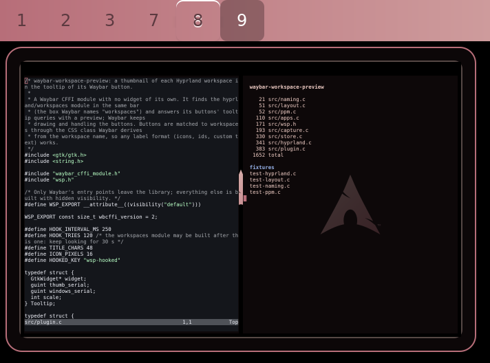
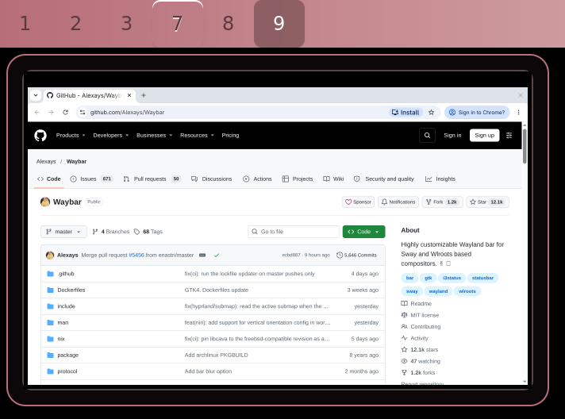
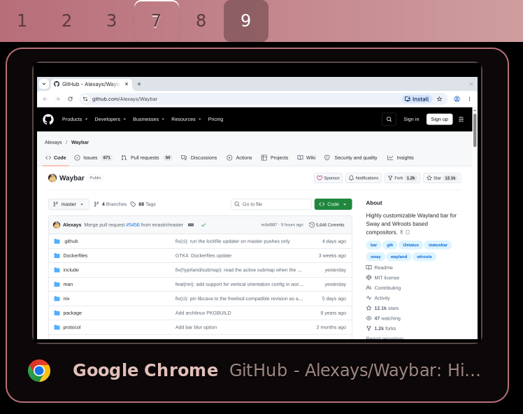
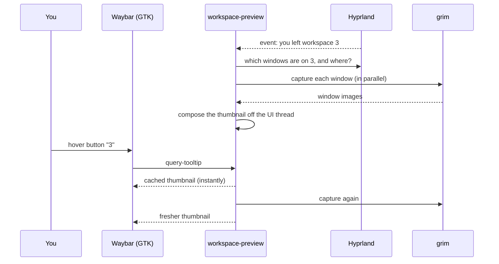

<h1 align="center">waybar-workspace-preview</h1>

<p align="center">
  <strong>Hover a workspace button in Waybar and see what is on it.</strong><br>
  Live thumbnails of your Hyprland workspaces, right in the workspace button's tooltip.
</p>

<p align="center">
  <a href="https://github.com/RandyNorthrup/waybar-workspace-preview/actions/workflows/ci.yml"></a>
  <a href="LICENSE"></a>
  
  
  
</p>

<p align="center">
  
</p>

## Features

- **Real thumbnails, not labels.** Every window on the workspace is captured and drawn where it sits on the
  monitor, over your wallpaper.
- **Works on hidden workspaces.** Windows are captured even when their workspace is not on screen.
- **Instant.** The last thumbnail shows the moment the tooltip opens; a fresh capture replaces it a fraction
  of a second later.
- **Fits any setup.** Any `hyprland/workspaces` label format (names, numbers, icons), HiDPI, special
  workspaces; built for multiple monitors and bars, mixed scales and rotated monitors (so far tested live on a
  single HiDPI display: multi-monitor reports are welcome).
- **Drop-in.** A single Waybar module: Waybar keeps drawing, styling and clicking the workspace buttons exactly
  as before. No daemon, no scripts, no extra processes.
- **Optional window list** with app icons and titles under the thumbnail.
- **Themeable** with plain Waybar CSS.

## Gallery

<table>
  <tr>
    <td align="center"><br><sub>A browser on another workspace</sub></td>
    <td align="center"><br><sub><code>"windows": true</code> adds the window list</sub></td>
  </tr>
</table>

## Requirements

| | |
|---|---|
| Compositor | [Hyprland](https://hyprland.org) with window capture support (`ext-foreign-toplevel-image-capture-source`); tested with 0.57.1 |
| Bar | [Waybar](https://github.com/Alexays/Waybar) with CFFI modules; tested with 0.16.0 |
| Capture | [grim](https://gitlab.freedesktop.org/emersion/grim) 1.5 or later (for `grim -T`) |
| Build | a C compiler, meson, ninja, pkg-config, GTK 3, json-glib |

## Install

### Arch Linux

```sh
git clone https://github.com/RandyNorthrup/waybar-workspace-preview
cd waybar-workspace-preview/packaging/arch
makepkg -si
```

The module is installed as `/usr/lib/waybar/waybar-workspace-preview.so`.

### Any distribution, with the install script

```sh
git clone https://github.com/RandyNorthrup/waybar-workspace-preview
cd waybar-workspace-preview
./install.sh            # just for you: ~/.local/lib/waybar/waybar-workspace-preview.so
./install.sh --system   # for everyone: /usr/local/lib/waybar/waybar-workspace-preview.so
```

It checks the build dependencies (and tells you the package names if one is missing), builds, installs and
prints the exact lines to paste into your Waybar config. `./install.sh --uninstall` removes it again.

<details>
<summary>Build dependencies by distribution</summary>

| Distribution | Command |
|---|---|
| Arch | `sudo pacman -S --needed base-devel meson gtk3 json-glib grim` |
| Debian / Ubuntu | `sudo apt install build-essential meson pkg-config libgtk-3-dev libjson-glib-dev grim` |
| Fedora | `sudo dnf install gcc meson gtk3-devel json-glib-devel grim` |

</details>

### Manually with meson

```sh
meson setup build --prefix=/usr --buildtype=release
meson compile -C build
sudo meson install -C build    # → /usr/lib/waybar/waybar-workspace-preview.so (libdir may vary)
```

## Set up Waybar

Add the module right after `hyprland/workspaces` and point `module_path` at the installed file:

```jsonc
"modules-left": ["hyprland/workspaces", "cffi/workspace-preview"],

"cffi/workspace-preview": {
  "module_path": "/usr/lib/waybar/waybar-workspace-preview.so"
}
```

> [!IMPORTANT]
> `module_path` must be an **absolute path**: Waybar does not expand `~` there.

Then **restart** Waybar (`pkill -x waybar; waybar &`). Reloading with `SIGUSR2` is not enough the first time or
after an update, because Waybar keeps an already loaded module in memory.

The module has no widget of its own: it takes no space in the bar. Put it in the same bar as the
`hyprland/workspaces` module it should preview (any position works).

## Options

All optional. See [`examples/config.jsonc`](examples/config.jsonc) for a complete example.

| Option | Default | Description |
|---|---|---|
| `width` | `320` | Thumbnail width in logical pixels (64–1920). The height follows the monitor's shape. |
| `windows` | `false` | Also list the open windows (icon, app name, title) under the thumbnail. |
| `wallpaper` | none | Image drawn behind the windows, e.g. `"~/Pictures/wall.png"` (`~` works here). |
| `wallpaper-fit` | `"fill"` | How the wallpaper is fitted: `fill`, `fit`, `stretch` or `center`. |
| `background` | `"transparent"` | Colour behind the wallpaper and windows (any CSS colour). Transparent shows the tooltip's own background. |
| `capture-on-leave` | `true` | Capture a workspace as you switch away from it, so its preview is ready. |
| `refresh-on-hover` | `true` | Capture again whenever a button is hovered. |
| `refresh-interval` | `1.5` | Seconds a capture stays fresh before hovering captures again. |
| `grim` | `"grim"` | The grim executable, if it is not on your `PATH`. |

> [!TIP]
> Match your wallpaper tool's setting with `wallpaper` and `wallpaper-fit` and the thumbnails look exactly like
> your desktop.

## Styling

The preview lives in Waybar's tooltip, so it is styled from Waybar's `style.css`:

| Selector | What it is |
|---|---|
| `tooltip` | The tooltip window (shared by all of Waybar's tooltips) |
| `.workspace-preview` | The box holding the thumbnail and the window list |
| `.workspace-preview-image` | The thumbnail |
| `.workspace-preview-window` | One row of the window list |

```css
tooltip {
  background: rgba(17, 17, 27, 0.95);
  border: 1px solid #89b4fa;
  border-radius: 12px;
  padding: 2px;
}
.workspace-preview-image {
  padding: 0;
  border: 1px solid rgba(205, 214, 244, 0.25);
  border-radius: 6px;
}
```

[`examples/style.css`](examples/style.css) has a complete starting point.

## How it works



- The module finds the `hyprland/workspaces` module in its bar and answers its buttons' tooltip queries.
  Buttons are matched to workspaces through the CSS class Waybar derives from each workspace's name, which is
  why any label format works.
- Window images come from `grim -T <window>` (Wayland's `ext-foreign-toplevel-image-capture-source`), which works
  for windows that are not on screen. Positions come from Hyprland's IPC socket.
- All bars share one Hyprland connection and one set of thumbnails. Captures run in the background and are
  composited on a worker thread, so the bar never stalls.

## Troubleshooting

<details>
<summary>The tooltip still shows only the workspace name</summary>

- Restart Waybar fully (`pkill -x waybar; waybar &`), not just reload.
- Check that the module is loaded: `grep workspace-preview /proc/$(pgrep -x waybar)/maps`. If nothing shows,
  `module_path` is wrong or not absolute.
- Run Waybar from a terminal and look for lines starting with `waybar-workspace-preview:`.
</details>

<details>
<summary>The thumbnail is empty or shows only the wallpaper</summary>

- `grim -T` needs grim 1.5 or later: `grim -h | grep -- -T`.
- Try a capture by hand: `grim -T "$(hyprctl clients -j | jq -r '.[0].stableId')" /tmp/test.png`.
  If this fails, your Hyprland is too old for window capture.
</details>

<details>
<summary>Previews never show up for workspaces with custom names</summary>

The module matches buttons by the `ws-…` / name CSS class Waybar adds to each workspace button. Older Waybar
releases without that class are matched by the button's text instead, which works when `format` shows the
workspace name (`"{name}"`). Updating Waybar fixes it for every format.
</details>

## Limitations and roadmap

- Hyprland only for now. The capture side is compositor-independent; Sway and niri support need their own
  window layout source. Contributions are welcome.
- Window decorations drawn by the compositor (borders, rounded corners, shadows) are not part of a window
  capture, so they do not appear in the thumbnail.
- Layer-shell surfaces (bars, notifications, wallpaper daemons) are not captured; use `wallpaper` to draw
  your wallpaper behind the windows.

## Development

```sh
meson setup build --werror -Db_sanitize=address,undefined
meson compile -C build
meson test -C build --print-errorlogs
clang-format --dry-run --Werror src/*.c src/*.h tests/*.c
```

The code is small and split by concern: `naming.c` (workspace → CSS class), `ppm.c` (grim output),
`layout.c` (geometry), `hyprland.c` (IPC and events), `capture.c` (grim and compositing), `apps.c` (window
names and icons), `store.c` (shared state) and `plugin.c` (the Waybar side). The pure parts have unit tests
with fixtures in `tests/fixtures`.

## License

[MIT](LICENSE). `include/waybar_cffi_module.h` is Waybar's module interface, also MIT.

Made for [Waybar](https://github.com/Alexays/Waybar) and [Hyprland](https://hyprland.org).
